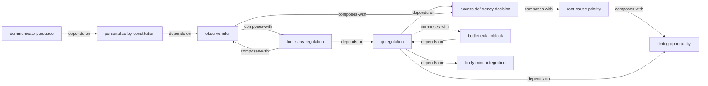

# 《黄帝内经·灵枢》— Skill Index

> 本书由 book2skill 蒸馏, 共产出 **10** 个 skills。
> 处理时间: 2026-04-18

## 关于这本书

- **作者**: 托名黄帝与岐伯、伯高、少师、少俞、雷公等臣子对话, 实为战国至西汉间多位医家集体编纂
- **出版年**: 约公元前4世纪—公元前1世纪
- **一句话主旨**: 以经络为人体运行的网络骨架, 以气血营卫为动力系统, 以九针为干预工具, 建立一套从生理认知到诊断到针刺治疗的完整临床操作体系
- **整书理解**: 见 [BOOK_OVERVIEW.md](./BOOK_OVERVIEW.md)

---

## Skill 列表 (按主题分组)

### 元方法论

- [`qi-regulation`](./qi-regulation/SKILL.md) — 调气治本: 干预的核心是恢复系统功能状态, 不是处理表面症状
- [`excess-deficiency-decision`](./excess-deficiency-decision/SKILL.md) — 虚实补泻: 判断"该加强还是该削减"的二元方向决策
- [`root-cause-priority`](./root-cause-priority/SKILL.md) — 标本根结: 区分根本原因与表面症状, 按缓急排序

### 诊断与推断

- [`observe-infer`](./observe-infer/SKILL.md) — 司外揣内: 从外部可观测信号推断内部隐藏状态
- [`four-seas-regulation`](./four-seas-regulation/SKILL.md) — 四海调节: 通过管理系统核心枢纽来调控整体

### 执行与优化

- [`bottleneck-unblock`](./bottleneck-unblock/SKILL.md) — 解结通滞: 找到系统阻塞点并精准疏通
- [`timing-opportunity`](./timing-opportunity/SKILL.md) — 时机选择: "何时做"比"做什么"更重要
- [`personalize-by-constitution`](./personalize-by-constitution/SKILL.md) — 因人施术: 根据个体差异调整方案参数

### 心身与沟通

- [`body-mind-integration`](./body-mind-integration/SKILL.md) — 形神合一: 心理状态与生理功能互为因果的管理框架
- [`communicate-persuade`](./communicate-persuade/SKILL.md) — 师传顺志: 四步沟通法(告败→语善→导便→开苦)

---

## 引用图



图例:
- `-->`  depends-on (使用前需先理解)
- `-.->` composes-with (经常配合使用)

---

## 推荐学习顺序

(从依赖图的叶子节点开始, 向上)

1. **qi-regulation** — 最基础, "调气治本"是所有其他skill的元原则
2. **excess-deficiency-decision** — 依赖调气, 是最常用的操作方向判断
3. **observe-infer** — 独立于虚实, 是诊断推理的基本方法
4. **root-cause-priority** — 虚实+因果链, 解决"先做什么"的问题
5. **timing-opportunity** — 加入时间维度, 解决"何时做"的问题
6. **body-mind-integration** — 引入心理维度, 补充心身关联视角
7. **bottleneck-unblock** — 具体疏通方法, 需要前面所有诊断能力
8. **four-seas-regulation** — 高级管理策略, 聚焦核心枢纽
9. **personalize-by-constitution** — 个体化调整, 需要诊断+评估能力
10. **communicate-persuade** — 沟通技巧, 需要理解个体差异后使用

---

## 与《素问》Skill的关系

灵枢10个skill与素问12个skill形成互补:

| 灵枢特有 | 素问特有 | 共享思维 |
|----------|----------|----------|
| qi-regulation (调气治本) | yin-yang-balance (阴阳平衡) | 根本原因导向 |
| bottleneck-unblock (解结通滞) | five-elements-network (五行生克) | 系统网络思维 |
| four-seas-regulation (四海调节) | cascade-prediction (传变预测) | 核心枢纽管理 |
| communicate-persuade (师传顺志) | context-adaptation (因地制宜) | 沟通与适应 |
| timing-opportunity (时机选择) | prevention-strategy (治未病) | 预防与时机 |
| personalize-by-constitution (因人施术) | seasonal-regimen (四时调养) | 个体化策略 |

---

## 接入 darwin-skill

所有 skill 均带有 `test-prompts.json` (darwin-skill 兼容格式), 可直接接入自动进化:

```
darwin evolve books/huangdi-neijing-lingshu/
```

---

## 审计轨迹

- 候选单元池: [candidates/](./candidates/)
- 被淘汰的候选 (含原因): [candidates/verified.md](./candidates/verified.md) (末尾淘汰表)
- BOOK_OVERVIEW: [BOOK_OVERVIEW.md](./BOOK_OVERVIEW.md)
