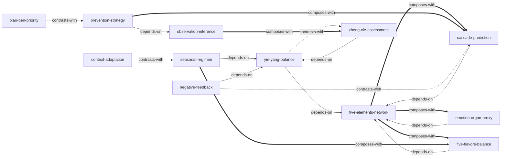

# 《黄帝内经·素问》— Skill Index

> 本书由 book2skill 蒸馏, 共产出 **12** 个 skills。
> 处理时间: 2026-04-18

## 关于这本书

- **作者**: 托名黄帝与岐伯等臣子对话, 实为战国至西汉间多位医家集体编纂
- **出版年**: 约公元前4世纪—公元前1世纪
- **一句话主旨**: 以阴阳五行为思维框架, 以脏腑经络为生理模型, 以四时气运为时空坐标, 建立一套"治未病"优先、天人合一的生命管理体系
- **整书理解**: 见 [BOOK_OVERVIEW.md](./BOOK_OVERVIEW.md)

---

## Skill 列表 (按主题分组)

### 元思维框架

- [`yin-yang-balance`](./yin-yang-balance/SKILL.md) — 阴阳平衡分析: 将一切归入阴阳两极, 判断盛虚并用对立面纠正
- [`five-elements-network`](./five-elements-network/SKILL.md) — 五行生克网络: 用相生相克关系图推导系统连锁效应
- [`negative-feedback`](./negative-feedback/SKILL.md) — 亢害承制调控: 识别过度亢盛的力量并引入制衡机制

### 决策与优先级

- [`biao-ben-priority`](./biao-ben-priority/SKILL.md) — 标本缓急决策: 区分根本原因与表面症状, 按"急则治标缓则治本"排序
- [`zheng-xie-assessment`](./zheng-xie-assessment/SKILL.md) — 正邪虚实判断: 评估"自身力量vs外部压力", 虚则补实则泻
- [`context-adaptation`](./context-adaptation/SKILL.md) — 因地制宜思维: 同一方案在不同环境/地域/场景下需本地化调整

### 预防与预测

- [`prevention-strategy`](./prevention-strategy/SKILL.md) — 治未病预防: 三层预防策略——未病先防、欲病早治、既病防变
- [`cascade-prediction`](./cascade-prediction/SKILL.md) — 脏腑传变预测: 沿五行相克链预判问题的连锁扩散路径

### 养生与调摄

- [`seasonal-regimen`](./seasonal-regimen/SKILL.md) — 四时调养法: 根据四季气机(生/长/收/藏)对齐起居饮食运动
- [`five-flavors-balance`](./five-flavors-balance/SKILL.md) — 五味调和原则: 酸苦甘辛咸各归其脏, 均衡则养偏嗜则伤
- [`emotion-organ-proxy`](./emotion-organ-proxy/SKILL.md) — 情志脏腑关联: 五种情绪对应五脏, 以情胜情可调节情绪

### 观察与推断

- [`observation-inference`](./observation-inference/SKILL.md) — 以外测内推理: 从外部可观测信号推断内部隐藏状态, 多信号交叉验证

---

## 引用图



图例:
- `-->`  depends-on (使用前需先理解)
- `-.->` contrasts-with (两种可选方案, 看情境选一)
- `===>` composes-with (经常配合使用)

---

## 推荐学习顺序

(从依赖图的叶子节点开始, 向上)

1. **yin-yang-balance** — 最基础, 所有其他skill的思维根基
2. **five-elements-network** — 依赖阴阳框架, 是多个skill的关系引擎
3. **observation-inference** — 独立于五行, 可与阴阳框架并行学习
4. **zheng-xie-assessment** — 依赖阴阳, 引入"力量对比"视角
5. **negative-feedback** — 依赖阴阳, 引入"制衡"视角
6. **cascade-prediction** — 依赖五行, 学习连锁预测
7. **emotion-organ-proxy** — 依赖五行, 情绪-脏腑映射
8. **five-flavors-balance** — 依赖五行, 饮食-脏腑映射
9. **seasonal-regimen** — 依赖阴阳, 配合五味调和
10. **prevention-strategy** — 依赖以外测内, 配合传变预测
11. **biao-ben-priority** — 独立于五行, 是优先级决策的通用工具
12. **context-adaptation** — 最灵活, 与四时调养对比学习

---

## 接入 darwin-skill

所有 skill 均带有 `test-prompts.json` (darwin-skill 兼容格式), 可直接接入自动进化:

```
darwin evolve books/huangdi-neijing-suwen/
```

---

## 审计轨迹

- 候选单元池: [candidates/](./candidates/)
- 被淘汰的候选 (含原因): [candidates/verified.md](./candidates/verified.md) (末尾淘汰表)
- BOOK_OVERVIEW: [BOOK_OVERVIEW.md](./BOOK_OVERVIEW.md)
